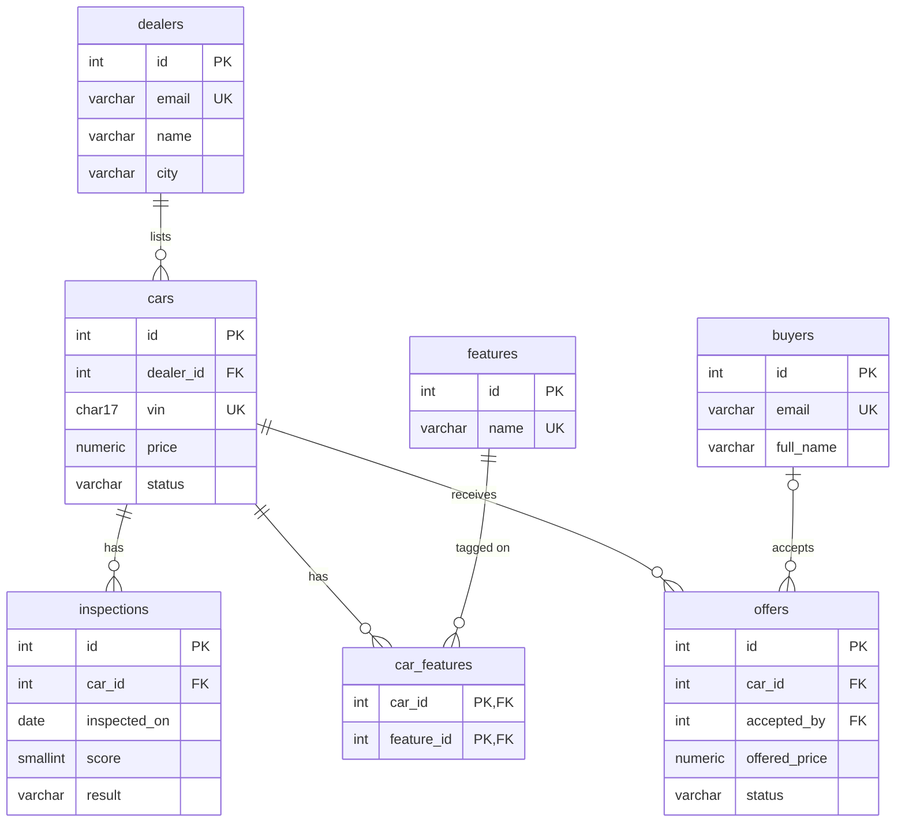

# Car Marketplace: Schema and Row Locking

Environment: PostgreSQL 16 in Docker (`docker run -d --name pgtrain -e POSTGRES_PASSWORD=pw -p 55432:5432 postgres:16`).
SQL lives in [sql/](sql/); raw outputs: [constraint_tests_output.txt](constraint_tests_output.txt), [race_nolock_output.txt](race_nolock_output.txt), [race_lock_output.txt](race_lock_output.txt).

## 1. Design

Entities: **dealers** own **cars**; cars have many **features** (many-to-many through `car_features`); cars get **inspections**; dealers publish **offers** on a car and a **buyer** accepts one (a `buyers` table was added because "accepting" needs someone to accept).



```
dealers 1 ──< cars 1 ──< inspections
                │ │
                │ └──< offers >── 0..1 buyers      (offers.accepted_by)
                └──< car_features >── features      (many-to-many)
```

Design decisions:

- Identity columns (`GENERATED ALWAYS AS IDENTITY`) instead of `SERIAL`; `TIMESTAMPTZ` instead of `TIMESTAMP`.
- Allowed values are enforced with `CHECK ... IN (...)`, so adding a status is a one-line migration.
- `ON DELETE`: a dealer or buyer with history cannot be deleted (`RESTRICT`); a car's inspections, offers and feature links go with the car (`CASCADE`).
- The offer row is the unit of contention, so the "one winner" rules are expressed as constraints, not just application code (see below).

## 2. CREATE TABLE ([sql/01_schema.sql](sql/01_schema.sql))

```sql
CREATE TABLE dealers (
    id         INTEGER GENERATED ALWAYS AS IDENTITY PRIMARY KEY,
    name       VARCHAR(100) NOT NULL CHECK (btrim(name) <> ''),
    email      VARCHAR(150) NOT NULL UNIQUE CHECK (email LIKE '%_@_%'),
    phone      VARCHAR(20)  CHECK (phone ~ '^\+?[0-9 -]{7,20}$'),
    city       VARCHAR(50)  NOT NULL,
    is_active  BOOLEAN      NOT NULL DEFAULT true,
    created_at TIMESTAMPTZ  NOT NULL DEFAULT now()
);

CREATE TABLE buyers (
    id         INTEGER GENERATED ALWAYS AS IDENTITY PRIMARY KEY,
    full_name  VARCHAR(100) NOT NULL CHECK (btrim(full_name) <> ''),
    email      VARCHAR(150) NOT NULL UNIQUE CHECK (email LIKE '%_@_%'),
    created_at TIMESTAMPTZ  NOT NULL DEFAULT now()
);

CREATE TABLE cars (
    id          INTEGER GENERATED ALWAYS AS IDENTITY PRIMARY KEY,
    dealer_id   INTEGER       NOT NULL REFERENCES dealers(id) ON DELETE RESTRICT,
    vin         CHAR(17)      NOT NULL UNIQUE CHECK (vin ~ '^[A-HJ-NPR-Z0-9]{17}$'),
    make        VARCHAR(50)   NOT NULL,
    model       VARCHAR(50)   NOT NULL,
    year        SMALLINT      NOT NULL CHECK (year BETWEEN 1990 AND 2030),
    mileage_km  INTEGER       NOT NULL DEFAULT 0 CHECK (mileage_km >= 0),
    price       NUMERIC(12,2) NOT NULL CHECK (price > 0),
    status      VARCHAR(10)   NOT NULL DEFAULT 'available'
                CHECK (status IN ('available','reserved','sold')),
    created_at  TIMESTAMPTZ   NOT NULL DEFAULT now()
);
CREATE INDEX idx_cars_dealer_id ON cars(dealer_id);
CREATE INDEX idx_cars_status    ON cars(status) WHERE status = 'available';

CREATE TABLE features (
    id   INTEGER GENERATED ALWAYS AS IDENTITY PRIMARY KEY,
    name VARCHAR(60) NOT NULL UNIQUE CHECK (btrim(name) <> '')
);

CREATE TABLE car_features (
    car_id     INTEGER NOT NULL REFERENCES cars(id)     ON DELETE CASCADE,
    feature_id INTEGER NOT NULL REFERENCES features(id) ON DELETE RESTRICT,
    PRIMARY KEY (car_id, feature_id)
);
CREATE INDEX idx_car_features_feature_id ON car_features(feature_id);

CREATE TABLE inspections (
    id             INTEGER GENERATED ALWAYS AS IDENTITY PRIMARY KEY,
    car_id         INTEGER      NOT NULL REFERENCES cars(id) ON DELETE CASCADE,
    inspected_on   DATE         NOT NULL,
    inspector_name VARCHAR(50)  NOT NULL,
    score          SMALLINT     NOT NULL CHECK (score BETWEEN 0 AND 100),
    result         VARCHAR(4)   NOT NULL CHECK (result IN ('pass','fail')),
    notes          TEXT,
    UNIQUE (car_id, inspected_on),
    CHECK ((result = 'pass') = (score >= 60))
);
CREATE INDEX idx_inspections_car_id ON inspections(car_id);

CREATE TABLE offers (
    id             INTEGER GENERATED ALWAYS AS IDENTITY PRIMARY KEY,
    car_id         INTEGER       NOT NULL REFERENCES cars(id)  ON DELETE CASCADE,
    offered_price  NUMERIC(12,2) NOT NULL CHECK (offered_price > 0),
    status         VARCHAR(10)   NOT NULL DEFAULT 'open'
                   CHECK (status IN ('open','accepted','expired','withdrawn')),
    accepted_by    INTEGER       REFERENCES buyers(id) ON DELETE RESTRICT,
    accepted_at    TIMESTAMPTZ,
    created_at     TIMESTAMPTZ   NOT NULL DEFAULT now(),
    expires_at     TIMESTAMPTZ   NOT NULL,
    CHECK (expires_at > created_at),
    CHECK ((status = 'accepted') = (accepted_by IS NOT NULL AND accepted_at IS NOT NULL))
);
CREATE INDEX idx_offers_car_id ON offers(car_id);
CREATE UNIQUE INDEX uq_offers_one_accepted_per_car ON offers(car_id) WHERE status = 'accepted';
```

Constraint summary: every table has a primary key; all foreign keys have an explicit `ON DELETE`; `UNIQUE` on emails, VIN, feature name and (car, inspection day); `CHECK`s on prices, mileage, year, VIN format, score range, status/result vocabularies, `result` agreeing with `score`, `expires_at > created_at`, and the offer's accepted fields being set exactly when its status is `accepted`; a partial unique index allows only one accepted offer per car.

### Constraints verified ([sql/03_constraint_tests.sql](sql/03_constraint_tests.sql))

Ten invalid statements were run against the seeded schema ([sql/02_seed.sql](sql/02_seed.sql)); all ten were rejected (bad VIN, duplicate VIN, missing dealer, negative price, bad status, `pass` with score 30, second inspection same day, accepted offer without a buyer, offer expiring in the past, deleting a dealer that still has cars). See [constraint_tests_output.txt](constraint_tests_output.txt).

## 3. Two buyers accept the same offer

Offer 1 is `open`. Alice is buyer 1, Bob is buyer 2. [sql/04_race.sh](sql/04_race.sh) opens two real `psql` sessions (A and B) and sends them commands in a fixed order.

### 3a. Without a lock (`./sql/04_race.sh nolock`)

```
[A] BEGIN                                [B] BEGIN
[A] SELECT ... WHERE id=1  -> open       [B] SELECT ... WHERE id=1  -> open
[A] UPDATE offers SET status='accepted', accepted_by=1 ...   -> UPDATE 1
[A] COMMIT
                                         [B] UPDATE offers SET status='accepted', accepted_by=2 ...  -> UPDATE 1
                                         [B] COMMIT
final: status=accepted, accepted_by=2 (Bob Buyer)
```

Both buyers read `open`, so both believed they could accept. Both `UPDATE`s returned `UPDATE 1` and both transactions committed. Alice was told her acceptance succeeded, but Bob's later write silently replaced it: a lost update. (B's `UPDATE` only waited for A's row lock; once A committed it overwrote the row without re-checking the status.) No constraint caught this, because the final row is valid on its own. Full output: [race_nolock_output.txt](race_nolock_output.txt).

### 3b. With `SELECT ... FOR UPDATE` (`./sql/04_race.sh lock`)

```
[A] BEGIN                                [B] BEGIN
[A] SELECT ... WHERE id=1 FOR UPDATE -> open   (A now holds the row lock)
                                         [B] SELECT ... WHERE id=1 FOR UPDATE   -> BLOCKS
third session: pg_stat_activity shows B with wait_event_type=Lock, wait_event=transactionid
[A] UPDATE offers SET status='accepted', accepted_by=1 ...   -> UPDATE 1
[A] COMMIT
                                         [B] lock released, row re-read -> status=accepted, accepted_by=1
                                         [B] app sees status <> 'open', rejects Bob -> ROLLBACK
final: status=accepted, accepted_by=1 (Alice Buyer)
```

B's `SELECT ... FOR UPDATE` waited until A committed, then returned the committed row (`accepted`, buyer 1) instead of the stale `open`. The application checks `status = 'open'` after taking the lock and rolls back, so exactly one buyer wins. Full output: [race_lock_output.txt](race_lock_output.txt). (In the saved file the `[A] COMMIT` line prints slightly after the following `---` note only because of output buffering; the commit happened first.)

The production pattern:

```sql
BEGIN;
SELECT status FROM offers WHERE id = $1 FOR UPDATE;        -- serialise on this row
-- application: if status <> 'open' or expires_at < now() -> ROLLBACK and tell the buyer "taken"
UPDATE offers SET status='accepted', accepted_by=$2, accepted_at=now() WHERE id=$1;
COMMIT;
```

An alternative needing no explicit lock is a guarded update, `UPDATE offers SET ... WHERE id=$1 AND status='open'`, and checking that it affected one row. `FOR UPDATE` is the better fit when other rows (e.g. `cars.status`) must change in the same transaction.
